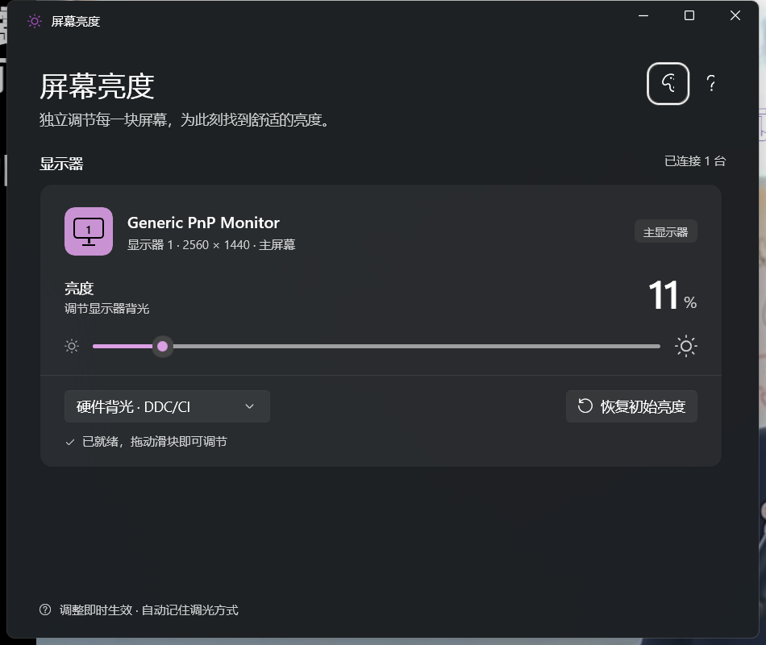

# AnyBright

**Windows 显示器亮度调节工具 —— 每块屏幕一个滑块，任何显示器都有效。**

**A Windows display brightness tool — one slider per screen, works on every monitor.**

简体中文 | [English](#english)

<p align="center">
  
</p>

[](https://github.com/Henry-GongZY/AnyBright/actions/workflows/release.yml)
[](https://github.com/Henry-GongZY/AnyBright/releases/latest)
[](LICENSE)

[下载最新版 Download](https://github.com/Henry-GongZY/AnyBright/releases/latest) · portable `.zip` 或安装包 `.exe`

## 为什么需要它

Windows 的亮度滑块只为笔记本内屏服务；外接显示器即使支持 DDC/CI，在 Win11 24H2 之前系统也不提供调节入口。AnyBright 把这条路补全：

- **硬件背光（DDC/CI）** —— 向显示器发送 VCP `0x10` 指令，让显示器调自己的背光，效果等同显示器上的摇杆按键，不损失对比度和色准
- **软件信号（Gamma）** —— 缩放显卡输出查找表，压暗输出画面。不依赖显示器配合，内屏、外接屏、不支持 DDC 的老显示器全都有效
- 双模式自动探测、随时切换，选择会被记住

## 特性

- WinUI 3 + Mica，跟随系统深浅色（右上角「外观」可强制浅色/深色）；原生标题栏、显示器卡片、高 DPI 与窄窗口自适应
- 每台显示器一张卡片，滑块即时生效（220ms 防抖 + 请求合并 + DDC 总线串行化，频繁拖动不丢指令、不撞车）
- Gamma 调光基线持久化（`%LOCALAPPDATA%\ScreenBrightness\`）：重启应用不叠加变暗，与 f.lux / 系统夜间模式兼容
- Gamma 滑块 0-100 直接映射到系统允许的 50%-100% 亮度范围（0 = 原先的 50%，拖到哪都不会被系统拒绝）；需要更深的压暗时用 CLI 的 `set` + `unlock`
- 显示器检测有加载态，失败或未连接时可一键重新检测
- 附带 PowerShell CLI，方便脚本与远程场景

## 安装

到 [Releases](https://github.com/Henry-GongZY/AnyBright/releases/latest) 下载：

| 文件 | 说明 |
|------|------|
| `AnyBright-x.y.z-win-x64-portable.zip` | 便携版（x64），解压即用（含 CLI 脚本），运行 `AnyBright.exe` |
| `AnyBright-x.y.z-setup-x64.exe` | 安装包（x64），带开始菜单/桌面快捷方式与卸载器 |
| `AnyBright-x.y.z-win-arm64-portable.zip` | 便携版（ARM64），解压即用（含 CLI 脚本） |
| `AnyBright-x.y.z-setup-arm64.exe` | 安装包（ARM64） |

系统要求：Windows 10 19041+ / Windows 11（x64 或 ARM64）。

## CLI 用法

便携版 zip 内自带 `brightness.ps1` / `bright.cmd`：

```text
bright list                 显示器列表 + 当前亮度 + DDC 支持探测
bright get [-Mode ddc]      读取当前亮度
bright set 70 [-Mode ddc]   设置亮度（0-100）
bright set 50 -Display 2    只调第 2 块屏幕
bright reset [-Mode ddc]    恢复记录的初始值
bright unlock               解除 gamma ~50% 下限（管理员，一次性）
```

`-Mode` 省略时为 `gamma`（软件信号）；`-Mode ddc` 为硬件背光。

## 已知限制

- **HDR 开启时 gamma 模式无效**（合成器接管输出路径），此时请用 DDC 模式
- 个别驱动（Surround / Eyefinity 分组屏）会把 gamma 应用到同组所有屏幕
- CLI 的 `set N` 是原始百分比语义（N = N% 亮度），与 GUI 滑块的 50-100 映射无关；未解锁时低于约 50% 会被系统拒绝

## 构建

```bash
dotnet publish App -c Release -p:Platform=x64 -r win-x64 --self-contained true -p:PublishTrimmed=true -o publish
```

## 致谢

界面与交互打磨由 [Codex](https://openai.com/codex/) 协作完成。

## 许可证

[MIT](LICENSE)

---

## English

**A Windows display brightness tool — one slider per screen, works on every monitor.**

简体中文 | **English**

### Why

Windows' brightness slider only serves laptop internal panels. External monitors get no brightness control from the OS — even when they support DDC/CI — until Windows 11 24H2. AnyBright fills that gap:

- **Hardware backlight (DDC/CI)** — sends VCP `0x10` commands so the monitor adjusts its own backlight, equivalent to the joystick button on the monitor, with no loss of contrast or color accuracy
- **Software signal (Gamma)** — scales the GPU output LUT to dim the picture. No monitor cooperation required: works on internal panels, external monitors, and old displays without DDC
- Both modes are auto-detected, switchable anytime; your choice is remembered

### Features

- WinUI 3 + Mica, follows system light/dark theme (「Appearance」in the top-right can force light/dark); native title bar, per-monitor cards, high-DPI and narrow-window adaptive layout
- One card per display; sliders apply instantly (220 ms debounce + request coalescing + serialized DDC bus — no dropped commands or collisions while dragging)
- Gamma dimming baseline persisted (`%LOCALAPPDATA%\ScreenBrightness\`): no compounding across restarts; compatible with f.lux / Night light
- The gamma slider's 0-100 maps onto the system-allowed 50%-100% brightness range (0 = the old 50%); for deeper dimming use the CLI `set` + `unlock`
- Display detection has a loading state with one-click re-scan on failure
- Ships with a PowerShell CLI for scripting and remote scenarios

### Install

Grab the latest from [Releases](https://github.com/Henry-GongZY/AnyBright/releases/latest):

| File | Description |
|------|-------------|
| `AnyBright-x.y.z-win-x64-portable.zip` | Portable (x64) — unzip and run `AnyBright.exe` (CLI scripts included) |
| `AnyBright-x.y.z-setup-x64.exe` | Installer (x64) with Start-menu/desktop shortcuts and an uninstaller |
| `AnyBright-x.y.z-win-arm64-portable.zip` | Portable (ARM64), CLI scripts included |
| `AnyBright-x.y.z-setup-arm64.exe` | Installer (ARM64) |

Requirements: Windows 10 19041+ / Windows 11 (x64 or ARM64).

### CLI Usage

The portable zip ships with `brightness.ps1` / `bright.cmd`:

```text
bright list                 list displays + current brightness + DDC probe
bright get [-Mode ddc]      read current brightness
bright set 70 [-Mode ddc]   set brightness (0-100)
bright set 50 -Display 2    adjust only display #2
bright reset [-Mode ddc]    restore the recorded initial value
bright unlock               lift the ~50% gamma floor (admin, one-time)
```

`-Mode` defaults to `gamma` (software signal); `-Mode ddc` is hardware backlight.

### Known Limitations

- **Gamma mode is ineffective while HDR is on** (the compositor takes over the output path) — use DDC mode instead
- Some drivers (Surround / Eyefinity grouped displays) apply gamma to every screen in the group
- The CLI's `set N` keeps raw percent semantics (N = N% brightness), independent of the GUI slider's 50-100 mapping; below ~50% is rejected by the system unless unlocked

### Build

```bash
dotnet publish App -c Release -p:Platform=x64 -r win-x64 --self-contained true -p:PublishTrimmed=true -o publish
```

### Acknowledgements

UI/UX polish in collaboration with [Codex](https://openai.com/codex/).

### License

[MIT](LICENSE)
